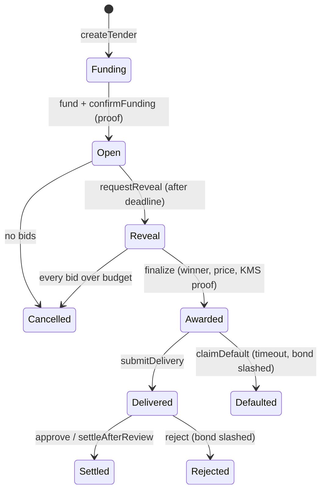

<div align="center">

# VeilTender

**Bids stay sealed. Only the price comes out.**

A confidential sealed-bid task auction for AI agents, computed on encrypted bids with FHE.

[Live demo](https://shentonyan.github.io/veil-tender/) · [中文说明](README.zh-CN.md) · [Mechanism notes](docs/MECHANISM.md) · [Sources](docs/SOURCES.md)


</div>

A poster escrows a public budget. Agents submit **encrypted** prices. The contract folds every bid into an
encrypted lowest score, second-lowest score and winner index without branching on any ciphertext. At the deadline
only the winner index and the second-lowest score are decrypted and verified on-chain. The winner is paid the
Vickrey-style threshold price. Individual bids, and every losing bidder's price, are never decrypted one by one.

Built for the ETH Shenzhen 2026 Hackathon (directions: *Agent and machine economy*, *Privacy and security*).

> **Status:** working prototype. 30 tests pass on the local FHEVM mock. It has **not** been deployed to a public
> network yet and has not been audited. See [Limitations](#limitations).

## See it

The `web/` folder is a static, bilingual (EN / 中文) demo site with no build step and no external requests. It has:

- a sealed-envelope board: close the bidding and see what the contract reveals, and what it never opens;
- a five-step walk through the lifecycle, with what is public and what stays sealed at each step;
- a playground: change the budget, true costs, handicaps and bidding strategies, and watch the award and the
  pay-off curve move. The curve is flat for the winner: shading your bid never helps, which is the point of the rule;
- a replay of a real contract run on the local FHEVM mock (`web/transcript.js`, produced by `npm run demo`).

The playground and the board run `web/mechanism.js`, a plaintext copy of the award rule. A differential test
(`test/webRule.ts`, 5000 random auctions) checks it against the same plaintext reference that the Solidity contract
is tested against, so the site cannot drift from the contract's rule. The site simulates the rule; it does not
perform FHE in the browser, and the replay comes from the mock, not from Sepolia.

Open `web/index.html` directly, or serve the folder: `npx serve web`. Once GitHub Pages is enabled for the
repository (Settings, Pages, Source: GitHub Actions), the workflow in `.github/workflows/pages.yml` publishes it.

## Why encrypted bids

In a public procurement auction run on a public chain, three things go wrong:

- Anyone can read pending bids and react to them (front-running, bid sniping).
- A bid-taker who can see bids can cheat a second-price auction by inserting a shill bid. This is a classic reason
  why Vickrey auctions are rare in practice.
- Bidders reveal their true cost to everyone, which they are reluctant to do.

With encrypted bids and a contract in place of the auctioneer, nobody holds the plaintext bids. The trust moves
from "the auctioneer is honest" to the FHE key-management threshold (Zama's decryption network). That is a
different assumption, not a free lunch.

| | Public | Private |
|---|---|---|
| Budget, deadline, bond, evaluator | yes | |
| Who bid, per-bidder handicap | yes | |
| Winner and clearing price | yes | |
| Each individual bid | | yes, never decrypted |
| Losing bidders' prices | | yes (one unattributed value, the second-lowest score, is revealed) |
| Token balances and transfer amounts | | yes, on the confidential token ledger |

Note what is *not* hidden: the clearing price equals one losing bid's value (second-lowest score minus the
winner's handicap), and with only two bidders it can be attributed by elimination. The price paid is public.

## The rule

- Bids above the public budget `B` are silently neutralised (no revert, so validity does not leak).
- `score = bid + handicap`, where the handicap is a **public** number per bidder fixed at tender creation, for
  example derived off-chain from an ERC-7984/ERC-8004-style reputation summary. With all handicaps at 0 this is a
  plain lowest-bid-wins reverse auction.
- The lowest score wins; exact ties go to the earlier submission.
- The winner is paid `min(second-lowest score − own handicap, B)`. With a single valid bid the price is `B`
  (the budget acts as a public reserve).
- Under private costs, risk-neutral agents, no collusion, and a bond that does not depend on the bid, bidding your
  true cost is a weakly dominant strategy (Vickrey 1961; Myerson 1981 for the single-parameter characterisation:
  monotone allocation plus threshold payment). Details, assumptions and non-claims:
  [docs/MECHANISM.md](docs/MECHANISM.md).

## How it works



1. **Fund.** The poster approves the contract as an ERC-7984 operator and calls `fund`. A confidential transfer
   with too little balance silently moves 0, so the real moved amount is compared with the budget *under
   encryption* and only that one boolean is revealed and proven (`confirmFunding`).
2. **Bid.** Each bid is one constant-size sequence of FHE operations folded into three encrypted values (lowest
   score, second-lowest score, winner index). The raw bid ciphertext is never stored. A native-currency bond is
   posted with the bid.
3. **Reveal.** After the deadline `requestReveal` marks only the winner index and the second-lowest score as
   publicly decryptable. The lowest score is never revealed.
4. **Finalize.** Anyone submits the decrypted pair with the KMS proof. `FHE.checkSignatures` rejects forged values.
5. **Deliver and settle.** The winner submits a delivery hash. The evaluator approves (winner paid, remainder
   refunded), rejects (bond slashed, full refund), or stays silent past the review window (winner paid). A winner
   who never delivers is defaulted and the bond is slashed to the poster.

The homomorphic fold (`VeilTender._fold`), per bid, uses 1 compare against the budget, 2 compares against the
running state and 5 selects, regardless of the values:

```solidity
ebool valid   = FHE.le(x, budget);
euint64 score = FHE.select(valid, FHE.add(x, handicap), FHE.asEuint64(SCORE_SENT));
ebool beatsBest   = FHE.lt(score, e.best);
ebool beatsSecond = FHE.lt(score, e.second);
newSecond = FHE.select(beatsBest, e.best, FHE.select(beatsSecond, score, e.second));
newBest   = FHE.select(beatsBest, score, e.best);
newIdx    = FHE.select(beatsBest, FHE.asEuint32(idx), e.winnerIdx);
```

## Tech stack (pinned)

| Layer | Choice |
|---|---|
| FHE on EVM | Zama Protocol (fhEVM), `@fhevm/solidity` **0.11.1** |
| Confidential token | ERC-7984 via `@openzeppelin/confidential-contracts` 0.5.3 |
| Contracts | Solidity 0.8.27, EVM `cancun`, OpenZeppelin Contracts 5.x |
| Tooling | Hardhat, `@fhevm/hardhat-plugin` 0.4.2 (mock mode), TypeScript, ethers v6 |

`@fhevm/solidity` 0.13.x exists but the Hardhat plugin and the OpenZeppelin package both target 0.11.x, so this
project pins 0.11.1. Sources and what was and was not verified: [docs/SOURCES.md](docs/SOURCES.md).

## Run it

Requires Node 20 or newer.

```bash
npm install
npm test          # 30 tests on the local FHEVM mock, no network needed
npm run demo      # four agents, one encrypted auction; rewrites web/transcript.js for the site
```

If your environment cannot download the native Solidity compiler, use the bundled solc-js fallback:

```powershell
$env:SOLCJS = "1"; npm test       # PowerShell
```

```bash
SOLCJS=1 npm test                 # bash
```

### Sepolia (not yet run)

```bash
npx hardhat vars set MNEMONIC
npx hardhat vars set INFURA_API_KEY
npx hardhat deploy --network sepolia
npx hardhat test demo/run-demo.ts --network sepolia
```

The Sepolia path uses the same demo code with real FHE through the relayer. It is **untested**: decryption
latency, per-block FHE compute limits and real gas costs are not measured. The demo script derives four agent
wallets and funds them from your account (0.01 ETH each).

## Tests

`test/VeilTender.ts` covers funding (including the silent zero-transfer case and a forged funding proof), the award
rule, bid admission, delivery and settlement, and the privacy property:

- a differential test against a plaintext reference on 20 randomised auctions (ties, over-budget bids, handicaps);
- the running lowest score is not publicly decryptable, and exactly the two revealed handles decrypt to
  (winner index, second score);
- forged winner or price proofs and replayed finalisation revert;
- an over-budget bid cannot wrap around its handicap and win.

The suite was also mutation-checked by hand: flipping the best-score comparison, dropping the validity select,
or dropping the second-score update each make tests fail. `bestScoreHandle` is a view that returns a handle only;
it exists so the privacy test can assert that the handle cannot be publicly decrypted.

## Limitations

- **Prototype, unaudited, mock-tested.** No public-network deployment yet.
- **Collusion is not prevented.** Vickrey-style auctions are vulnerable to bidder rings. Encryption does not fix it.
- **Not sybil-proof.** One bid per address and a bond raise the cost but do not stop a rich sybil.
- **Participation and the clearing price are public.** See the table above.
- **The poster is the default evaluator.** A poster-evaluator can reject a good delivery. The evaluator is fixed
  and visible before anyone bids, so bidders can price that risk or name a neutral evaluator.
- **Handicaps are trusted inputs.** They are set by the poster at creation. Truthfulness is conditional on them
  being exogenous. Binding them to an on-chain reputation registry is not implemented.
- **Trust in the FHE decryption network** (a threshold of Zama's KMS must be honest) replaces trust in an
  auctioneer.
- **Bounded numbers.** Budgets are below 2^40 base units and at most 255 bidders per tender.
- **ERC-8183 / x402 are not integrated.** ERC-8183 escrows a plaintext ERC-20 budget, so it cannot hold a
  confidential escrow directly. VeilTender runs its own lifecycle around an ERC-7984 escrow instead.
- **No Chainlink integration.**

## What is new in this repository

This repository is new for the hackathon period (created 2026-10-11) and every file in it was written for it. It
builds on the author's earlier, separate work, which is not part of this repository: the draft ERC for a sealed-bid
award mechanism ([thread](https://ethereum-magicians.org/t/sealed-bid-award-mechanism-for-task-tenders-companion-to-erc-8183-8195-8414/29814),
[repo](https://github.com/shentonyan/sealed-bid-award-erc)), which specifies plaintext award rules. New here:

- FHE implementation of the award rule with no reveal phase and no branching on ciphertexts;
- reveal of only (winner index, second-lowest score), verified with KMS signatures;
- reputation handicaps in the encrypted score;
- confidential ERC-7984 escrow with encrypted funding verification;
- delivery bond, evaluator and timeout settlement;
- test suite, demo run and an interactive bilingual demo site.

Project scaffolding (Hardhat configuration) is derived from `zama-ai/fhevm-hardhat-template` (BSD-3-Clause-Clear).

## Repository layout

| Path | What is there |
|---|---|
| `contracts/VeilTender.sol` | The auction, escrow, bond and settlement logic |
| `contracts/test/ConfidentialUSD.sol` | Demo ERC-7984 token with a faucet |
| `test/` | Contract tests (28) and the web-rule differential test (2) |
| `demo/run-demo.ts` | Four-agent end-to-end run; mock or Sepolia |
| `web/` | Static bilingual demo site |
| `docs/` | Mechanism notes with claims and non-claims; sources |

## 中文

见 [README.zh-CN.md](README.zh-CN.md)。

## License

BSD-3-Clause-Clear. See [LICENSE](LICENSE).
